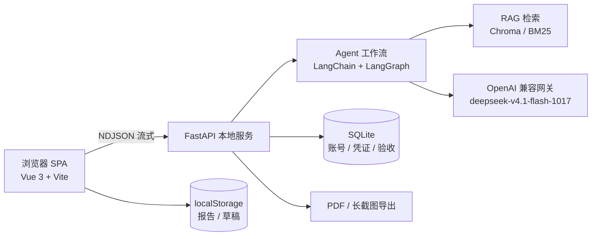
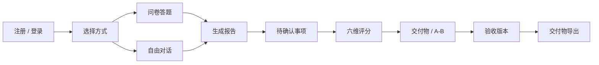
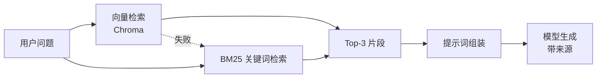

# 极构 · 需求诊断顾问 技术文档

> 2026 第九届传智杯全国大学生数智创新与 AI 应用大赛  
> 赛道：AI WEB 网页开发挑战赛（团队赛）  
> 团队：沧州交通学院 · 极构团队 · B 组  
> 成员：贾宇航、吴思彤、马翌焜　指导教师：王玉潇

## 摘要

中小微企业、个体创业者在数字化过程中普遍面临同一个问题：知道自己「想做个系统」，却说不清要做什么、大概多少钱、还缺哪些准备。传统做法是找外包反复沟通，沟通成本高，报价也难以横向比较。

极构是一款面向非技术用户的 AI 需求诊断 Web 应用。它用「问卷 + 自由对话」两种方式收集信息，基于 12 篇软件开发知识库做 RAG 检索，由大模型按「已具备 / 还缺失 / 待确认」三段式输出诊断结论；随后生成需求诊断报告、待确认事项清单、六维成熟度评分、PRD、开发询价清单、成本工期估算与 A/B 方案，并提供带版本与差异的验收凭证。

系统采用 Vue 3 + Vite 构建自适应前端，FastAPI 提供本地服务，LangChain Agent 负责工具调用与会话记忆，RAG 采用 Chroma 向量检索与 BM25 关键词检索双通道，异常时自动降级；数据使用单文件 SQLite，报告按账号隔离存储在浏览器本地。整套系统通过 `python run.py` 一条命令启动，无需数据库服务或容器。

**关键词**：AI Agent；RAG；需求诊断；Vue 3；FastAPI；AI 安全

---

## 一、项目概述

### 1.1 背景与问题

数字化转型已经下沉到街边门店、工作室和初创团队，但大多数需求方没有技术背景。他们能描述「我想要一个点单小程序」，却很难回答：要不要会员体系、支付资质是否具备、预算 3 万和 15 万差在哪里、上线前还需要准备什么。信息不对称直接导致两类结果：一是被外包牵着走，二是反复改需求、工期与费用失控。

现有工具要么是通用聊天机器人，回答泛泛而谈；要么是需求管理软件，默认使用者已经懂研发流程。缺的是一个站在需求方一侧、能主动提问并给出结构化判断的工具。

### 1.2 作品定位

极构的定位是「需求诊断顾问」而不是「开发教程」。它只做三件事：

1. 判断需求已经想清楚了什么；
2. 对照知识库还缺什么；
3. 把需要拍板的问题列出来。

所有输出都服务于一个目标：让需求方在找开发之前，先把需求变成可以沟通、可以询价、可以验收的材料。

### 1.3 目标用户

- 中小微企业主与个体经营者：想做点单、预约、会员、进销存等业务系统，但没有技术团队。
- 创业团队与产品新人：需要把想法整理成 PRD，用于内部立项或对外询价。
- 高校学生与参赛团队：需要快速梳理项目需求，形成规范文档。

### 1.4 主要成果

- 可在 PC 与手机浏览器使用的 AI Native Web 应用，覆盖注册登录、诊断、报告、验收、导出的完整闭环。
- 12 篇原创软件开发知识库与双通道 RAG 检索，保证离线 / 弱网环境下也能完成检索增强。
- 可复用的提示词与结构化输出方案：问卷、报告、评分、待确认项、交付物、A/B 方案、修订。
- 本地单文件 SQLite + 按账号隔离的浏览器存储，零外部服务依赖，一条命令启动。

---

## 二、需求分析

### 2.1 用户痛点

| 痛点 | 具体表现 | 对设计的要求 |
| --- | --- | --- |
| 说不清需求 | 只知道「想做个系统」，无法描述角色、流程、边界 | AI 主动提问，一题一问，允许口语化表达 |
| 看不懂报价 | 不同开发方报价差异大，不知道钱花在哪 | 给出预算区间、成本构成与询价清单 |
| 不知道还缺什么 | 漏掉支付资质、备案、会员体系等关键项 | 对照知识库做完整性诊断，明确「还缺失」 |
| 怕做完不认账 | 口头确认多、书面凭证少，改需求容易扯皮 | 验收凭证、版本号与 diff 留痕 |

### 2.2 功能需求

| 模块 | 功能 | 说明 | 优先级 |
| --- | --- | --- | --- |
| 账号 | 注册 / 登录 / 改密 / 注销 | 手机号 + 强密码，Bearer Token 鉴权，按账号隔离数据 | P0 |
| 诊断 | 问卷答题 | AI 逐题生成，支持单选 / 多选 / 文本、补充说明、上一题 | P0 |
| 诊断 | 自由对话 | 流式输出，展示知识库检索与思考状态，支持停止生成 | P0 |
| 报告 | 需求诊断报告 | 五段式结构：概述 / 已具备 / 还缺失 / 待确认 / 下一步 | P0 |
| 报告 | 待确认事项 | 抽取模糊、缺失、冲突项，逐条拍板；支持一键全部确认与进度条 | P0 |
| 评估 | 六维成熟度评分 | 形态、用户、功能、预算、时间、合规 + 风险提示 | P1 |
| 交付物 | PRD / RFP / 成本工期 | 基于报告生成三份可直接使用的材料 | P1 |
| 决策 | A/B 方案 | MVP 与完整版对比，给出推荐与理由 | P1 |
| 验收 | 版本与凭证 | SHA-256 指纹、版本号、diff、验收凭证导出 | P1 |
| 内容 | 模板库 / 案例库 | 内置需求模板与案例成品，支持搜索、预览、导出、一键带入诊断 | P2 |
| 内容 | 我的图纸 | 按账号归档，支持搜索、删除与状态徽章 | P1 |
| 导出 | MD / PDF / 长截图 | 服务端 PDF 排版，前端长截图；Markdown 支持代码高亮与一键复制 | P2 |

### 2.3 非功能需求

| 维度 | 要求 | 实现方式 |
| --- | --- | --- |
| 性能 | 首屏可交互、对话逐字输出 | 前端单文件构建、路由懒加载；后端 NDJSON 流式返回 |
| 可用性 | 外部模型 / 向量服务异常时仍可演示 | 向量检索失败自动降级 BM25；模型异常返回友好提示 |
| 安全 | 密码不落明文、接口需鉴权、Key 不进仓库 | PBKDF2-SHA256 + 随机盐；Bearer Token；`.env` / `local_config.py` 均被忽略 |
| 兼容 | PC 与手机浏览器均可使用 | 320 / 390 / 834 / 1440 四档宽度实测，无横向溢出 |
| 隐私 | 个人数据尽量留在本机 | SQLite 单文件 + 浏览器本地存储，不依赖第三方云服务 |
| 可维护 | 一条命令启动，配置外置 | `run.py` 自动建虚拟环境、装依赖、构建前端并启动 |

### 2.4 约束与假设

- 运行环境为 Windows / macOS / Linux 的本地电脑，需要 Python 3.11+ 与 Node.js 18+。
- 模型通过 OpenAI 兼容网关调用，需要有效的 API Key；无 Key 时应用仍可启动并给出明确提示。
- 本期不依赖云数据库、对象存储与容器平台，报告正文保存在浏览器本地。

---

## 三、系统架构设计

### 3.1 总体架构



系统采用「浏览器 SPA + 本地 FastAPI 服务 + 模型网关」的三层结构。浏览器负责交互与本地存储，FastAPI 负责鉴权、AI 编排、检索、结构化输出与文件导出，模型网关只负责推理。前后端通过 NDJSON 流式协议通信，部署时由 FastAPI 直接托管前端构建产物，因此只需要一个进程。

### 3.2 技术选型

| 层次 | 选型 | 选型理由 |
| --- | --- | --- |
| 前端框架 | Vue 3.5 + Vite 8 | 组合式 API、构建快；单文件产物便于本地托管 |
| 状态与路由 | Pinia 4 + Vue Router 5 | 轻量、类型友好；路由守卫统一处理登录态 |
| 后端 | FastAPI + Pydantic | 声明式接口、自动文档、原生流式响应 |
| AI 编排 | LangChain 1.4 + LangGraph 1.2 | Agent、工具调用、会话记忆开箱可用 |
| RAG | Chroma（可选）+ 自研 BM25 | 向量召回 + 关键词兜底，避免单点依赖 |
| 数据库 | SQLite（标准库 sqlite3） | 单文件、零运维，适合本地单机场景 |
| 导出 | reportlab + html2canvas | 服务端排版 PDF，前端生成高清长截图 |
| 代码高亮 | markdown-it + highlight.js | 统一渲染、代码块复制、外链安全 |

### 3.3 前端架构

前端按「页面 - 组件 - 状态 - 接口」四层组织。页面负责路由级布局；组件承担对话气泡、问题卡、评分卡、文档卡等可复用 UI；Pinia 管理账号、对话、问卷、报告归档与分析草稿；api 层统一附加 Token、解析 NDJSON 并处理 401。

复杂交互进一步拆为 `ConfirmModal`、`DeliverablesCard`、`AbPlanCard` 等独立组件；Markdown 统一由 `utils/markdown.js` 渲染，集中处理代码高亮、复制按钮与外链安全，避免各页面重复实现。

响应式采用内容驱动而非设备判断：桌面端使用双栏 Hero 与顶部导航，移动端压缩为单栏并保留底部 Tab；表格、卡片与弹层在窄屏自动改为单列。

### 3.4 后端架构

| 模块 | 文件 | 职责 |
| --- | --- | --- |
| HTTP 与鉴权 | `app.py` | 路由、Bearer Token 校验、请求校验、流式响应、文件导出 |
| AI 核心 | `agent_core.py` | 模型客户端、提示词、Agent、结构化生成与事件协议 |
| 检索 | `retrieval.py` | BM25 索引、切片、停用词、标题加权与同源去重 |
| 安全 | `safety.py` | 输入审查、注入识别、敏感信息脱敏 |
| 数据 | `db.py` | 账号、登录凭证、验收记录的 SQLite 读写 |
| 导出 | `pdf_export.py` | Markdown 报告的 PDF 排版 |
| 启动 | `run.py` | 虚拟环境、依赖、前端构建、端口选择与服务启动 |

### 3.5 数据模型

本地数据库为一个 SQLite 文件（`backend/data/jigou.db`），只保存需要跨会话保留的三类数据：账号、登录凭证、验收记录。报告正文、评分、交付物与草稿保存在浏览器 `localStorage` 中，键名包含账号，因此同一浏览器切换账号不会互相看到数据。

| 表 | 字段 | 说明 |
| --- | --- | --- |
| `users` | id, username, password_hash, salt, created_at | 手机号唯一；密码 PBKDF2-SHA256（10 万次迭代 + 随机盐） |
| `tokens` | token, username, created_at | 登录凭证；每次登录重新生成，一个账号只保留一个有效 token |
| `acceptances` | id, username, doc_hash, content, confirm_items, resolutions, project_key, version, diff, accepted_at | 验收凭证：报告原文、待确认决策、SHA-256 指纹、版本与差异 |

### 3.6 接口设计

| 接口 | 方法 | 鉴权 | 说明 |
| --- | --- | --- | --- |
| `/api/register` | POST | 否 | 注册（手机号 + 强密码） |
| `/api/login` | POST | 否 | 登录并签发 Token |
| `/api/logout` | POST | 是 | 使当前 Token 失效 |
| `/api/me` | GET | 是 | 当前账号信息 |
| `/api/change_password` | POST | 是 | 修改密码 |
| `/api/delete_account` | POST | 是 | 注销账号并级联删除数据 |
| `/api/chat` | POST | 是 | 流式对话（NDJSON） |
| `/api/questionnaire` | POST | 是 | 生成下一题 |
| `/api/generate_doc` | POST | 是 | 生成诊断报告 |
| `/api/accept` | POST | 是 | 保存验收记录与版本 |
| `/api/assessment` | POST | 是 | 六维评分与风险 |
| `/api/deliverables` | POST | 是 | PRD / RFP / 成本工期 |
| `/api/ab_plan` | POST | 是 | A/B 方案 |
| `/api/revision` | POST | 是 | 按意见修订报告 |
| `/api/export_pdf` | POST | 是 | 导出 PDF |
| `/api/health` | GET | 否 | 模型、知识库、数据库自检 |

### 3.7 关键流程



一次完整使用从注册登录开始，经过模式选择、信息收集、报告生成、待确认事项、验收版本，最终产出交付物。每一步都支持回退：问卷可回上一题，对话可放弃，报告可修订后重新验收。

---

## 四、AI 技术方案

### 4.1 模型接入与选型

模型通过 OpenAI 兼容协议接入，默认网关为 `https://maas.qianwenaiapi.com/compatible-mode/v1`，模型型号 `deepseek-v4.1-flash-1017`。选择兼容协议而不是绑定某家 SDK，原因有三点：

1. 便于在比赛网关、云端 API 与本地模型之间切换；
2. LangChain 生态可直接复用；
3. 请求与响应格式稳定，便于做流式解析与错误兜底。

所有模型参数集中在 `config.py`：Key 支持环境变量、`.env` 与本地 `local_config.py` 三种来源，`temperature` 固定为 0 以保证结构化输出稳定；`enable_thinking` 采用「未设置就不发送」的策略，避免不同网关对未知字段的兼容性差异。

### 4.2 Agent 设计

对话链路由 LangChain 的 `create_agent` 构建，挂载一个 `search_knowledge` 工具与 `InMemorySaver` 会话记忆。Agent 的职责不是闲聊，而是按系统提示词完成三件事：

1. 判断信息是否足够；
2. 必要时调用知识库；
3. 按「已具备 / 还缺失 / 待确认」结构输出。

工具调用参数与结果会通过事件协议实时推给前端，用户能看到「正在检索知识库」而不是干等。问卷、评分、交付物等一次性任务不复用 Agent，而是走 `build_llm()` 的同步调用，避免把多轮工具调用带进结构化生成。

### 4.3 RAG 设计



知识库由 12 篇原创文档组成，覆盖需求文档、技术选型、开发流程、需求澄清、项目诊断、商业模式、角色权限、报价、工期、资质、风险与非功能需求。文档按 400 字、80 字重叠切片，共 32 个片段。

检索采用双通道：配置了 `EMBEDDING_MODEL` 且向量库可用时走 Chroma 相似度检索；未配置、向量库缺失或调用异常时自动切换自研 BM25。BM25 针对中文做了单字 + 二元切分、停用词过滤、标题加权与同源去重，既不依赖分词库，也能在小语料下保持可用的排序质量。

双通道的意义不只是「多一种检索」：比赛现场的网络与网关不可控，如果 RAG 依赖单一向量服务，一次超时就会让演示中断；降级方案保证「检索 → 增强 → 生成」链路始终可演示，并通过 `/api/health` 暴露当前检索模式，便于排查。

### 4.4 提示词工程

| 场景 | 关键约束 | 稳定性措施 |
| --- | --- | --- |
| 对话诊断 | 三段式结构；禁止输出实现步骤；先判断信息是否足够 | 系统提示词写死安全边界与工具使用规则 |
| 问卷出题 | 一次只问一个点；口语化；输出固定 JSON | 去代码块 + 正则兜底解析，失败回落默认问题 |
| 报告生成 | 只使用问卷与对话中出现的信息；固定五段结构 | 以问卷答案为准，冲突写入「待确认」 |
| 待确认项 | 输出 JSON 数组，区分模糊 / 缺失 / 冲突 | 逐项校验字段，非法项丢弃 |
| 评分 | 六维 0–100，风险最多 5 条 | 数值裁剪到 0–100，非法等级回落 medium |
| 交付物 / A/B | 只输出 JSON，字段为 Markdown 字符串 | 解析失败返回空结构，前端展示空状态 |

### 4.5 内容输出

- 文档导出：服务端 reportlab 生成 PDF；前端 html2canvas 以 2 倍分辨率生成长截图。
- 格式覆盖：Markdown、PDF、长截图，报告、评分、验收凭证均可导出分享。
- 本期范围：聚焦文本交互与文档产出，语音、图像等多模态能力未纳入当前版本。

### 4.6 AI 安全与可控性

安全分三层：

- 输入侧：用规则拦截危险物品、入侵窃取、未成年人色情、代写论文等请求，并识别「忽略之前指令 / 输出系统提示词 / 开发者模式」等注入话术；
- 模型侧：在系统提示词中写明不泄露提示词、不臆造政策与价格、涉及个人信息时提醒合规；
- 输出侧：对所有异常信息做密钥脱敏，保证 API Key 不会通过报错回显到前端。

模型未配置 Key、网关超时、结构化解析失败都有明确兜底：返回可读提示或空结构，不让页面白屏，也不把底层异常直接抛给用户。

### 4.7 性能与成本优化

- 流式输出：对话逐字返回，首 token 到达即可阅读，降低等待感。
- 懒加载：Agent 与向量库都在首次使用时初始化，未配置 Key 也能秒开页面。
- 输入限制：单条输入 2000 字，避免超长上下文带来的费用与延迟。
- 温度 0 + 固定结构：降低重试率，减少无效调用。
- 本地检索兜底：向量服务不可用时不再重试外部接口，直接走 BM25。

---

## 五、核心功能实现

### 5.1 账号与鉴权

注册要求 11 位手机号，密码至少 8 位且包含大写、小写、数字、符号中的三种；密码使用 PBKDF2-SHA256（10 万次迭代 + 16 字节随机盐）哈希后入库，不保存明文。登录成功签发 64 位随机 Token，服务端只保留每个账号最新的一条，旧登录自动失效。

前端把 Token 存在 `localStorage`，所有请求统一加 `Authorization` 头；路由守卫拦截未登录访问，接口返回 401 时由全局处理器清理会话并跳回登录页。

### 5.2 问卷与对话

问卷以一个种子问题开场，每次提交后由模型根据已答内容生成下一题，支持单选、多选与文本，并可随时回退上一题或在题目下补充说明。信息足够时模型主动收尾，给出小结并邀请生成报告。

自由对话直接进入 Agent：用户消息、知识库检索、模型回答以 NDJSON 事件流式传输，前端根据 `token / tool_start / tool_end / thinking / done` 更新气泡、检索状态与思考提示。生成过程中可随时停止，已输出内容会保留并标注「已停止生成」。

Markdown 回答支持代码高亮、一键复制与外链新窗口打开；代码块直接由自定义 `fence` 渲染器输出「语言栏 + 复制按钮 + 代码」，避免嵌套 `<pre>`。

### 5.3 报告、评分与交付物

报告生成时会把问卷答案与自由对话合并，按「项目概述、已具备、还缺失、待确认问题清单、建议下一步」五段输出；同时抽取待确认事项，逐条标注模糊、缺失或冲突。评分从形态、用户、功能、预算、时间、合规六个维度给出 0–100 分与风险提示。

待确认事项以卡片逐条展示，支持「已确认 / 不涉及 / 补充说明」，并提供一键全部确认、已确认计数与进度条；全部决定后才能提交验收，避免漏项。

交付物模块一次生成 PRD、RFP 与成本工期估算，A/B 方案则给出 MVP 与完整版的对比及推荐。

### 5.4 验收与版本管理

每次验收会计算报告正文与决策项的 SHA-256 指纹，按「账号 + 项目标识」递增版本号，并与上一版做行级 diff。凭证包含验收编号、账号、时间、版本、指纹与逐项结论，可导出 Markdown。这样即使后续改需求，也能追溯每一版确认了什么。

### 5.5 导出、模板库、我的图纸与多端适配

报告支持 Markdown、PDF 与长截图三种导出；模板库内置多行业需求模板与案例成品，可搜索、预览并导出，并支持「以此开始诊断」把模板摘要直接带入首页输入框。

「我的图纸」支持按标题或日期搜索、删除二次确认，并用徽章标出草稿 / 已验收、成熟度与交付物状态。界面针对桌面与手机分别优化：桌面使用双栏 Hero 与顶部导航，手机压缩为单栏、保留底部 Tab，320px 小屏也不会出现横向滚动。

---

## 六、测试与部署

### 6.1 测试方法

- 接口测试：用 FastAPI TestClient 覆盖注册、登录、鉴权、验收、改密、注销等主路径与异常路径。
- 数据隔离测试：两个账号对同一项目验收，验证版本号互不影响；删除账号后另一账号数据保留。
- 浏览器测试：用 Playwright 在 320 / 390 / 834 / 1440 四档宽度跑注册、登录、对话、报告、模板库、我的图纸、个人中心。
- 异常测试：伪造 Token 验证自动跳登录；未配置 Key 验证提示；重复注册、弱密码、错密码验证错误码。

### 6.2 关键用例

| 用例 | 预期 | 结果 |
| --- | --- | --- |
| 未登录访问 `/api/me`、`/api/chat`、`/api/accept` | 返回 401 | 通过 |
| 弱密码注册 / 重复注册 | 400 / 409 | 通过 |
| 错误密码登录 / 正确登录 | 401 / 200 + Token | 通过 |
| 登出后使用旧 Token | 401 | 通过 |
| 改密后旧密码登录 | 401 | 通过 |
| 注销账号后登录 | 401，验收记录清零 | 通过 |
| A/B 两账号同项目验收 | 各自从 v1 开始 | 通过 |
| 同账号连续验收 | v1 → v2，返回 diff | 通过 |
| 伪造 Token 打开首页 | 自动跳转登录页 | 通过 |
| 模板库「以此开始诊断」 | 跳转首页并预填模板摘要 | 通过 |
| Markdown 代码块 | 高亮、复制按钮、无嵌套 `pre` | 通过 |
| 待确认事项一键全部确认 | 进度 2/2，验收按钮可用 | 通过 |
| 我的图纸搜索 / 删除 | 命中标题、删除二次确认 | 通过 |
| 320–1440 宽度浏览各页面 | 无横向滚动、无控制台报错 | 通过 |

### 6.3 部署与运行

项目不依赖 Docker 或云数据库。根目录执行 `python run.py` 后，脚本会依次完成：创建 `backend/.venv`、安装后端依赖、安装并构建前端、选择可用端口、启动 FastAPI 并打开浏览器。首次打开进入登录页，注册后即可使用。

常用命令：

```bash
python run.py                # 构建并启动
python run.py --dev          # Vite 热更新 + FastAPI
python run.py --port 8001    # 指定端口
python run.py --rebuild      # 强制重建前端
```

### 6.4 环境配置

| 变量 | 必填 | 默认值 | 说明 |
| --- | --- | --- | --- |
| `LLM_API_KEY` | 是 | — | 模型网关 Key，写在 `backend/.env` 或 `local_config.py` |
| `LLM_BASE_URL` | 否 | `https://maas.qianwenaiapi.com/compatible-mode/v1` | OpenAI 兼容网关 |
| `LLM_MODEL` | 否 | `deepseek-v4.1-flash-1017` | 模型型号 |
| `LLM_ENABLE_THINKING` | 否 | 不发送 | 设置 0 / 1 才显式传给网关 |
| `EMBEDDING_MODEL` | 否 | 空 | 配置后启用向量检索，否则用 BM25 |
| `DB_PATH` | 否 | `backend/data/jigou.db` | SQLite 文件位置 |

依赖清单见 `backend/requirements.txt` 与 `frontend/package.json`；环境变量模板为 `backend/.env.example`。所有真实 Key 均通过 `.gitignore` 排除，不会进入公开仓库。

---

## 七、创新点

### 7.1 技术创新

- **诊断式 Agent 工作流**：把「主动判断信息是否足够」写进系统提示词，让 Agent 决定继续追问还是收尾，而不是固定轮次收集。
- **RAG 双通道自动降级**：向量检索与 BM25 共用同一检索接口，向量服务异常时无感切换，保证演示与离线可用。
- **结构化输出的容错解析**：针对模型可能返回代码块、前后缀说明的情况，统一去围栏 + 正则兜底 + 字段校验，避免一次解析失败导致整条流程中断。
- **NDJSON 事件协议**：把思考、工具调用、正文增量、结束与错误统一成一行一个事件，前端只需一套解析逻辑。
- **按账号隔离的本地存储**：账号与凭证入库，报告按账号存浏览器，既满足多用户，又避免上传隐私数据。
- **验收版本与 diff**：报告验收生成指纹、版本号与差异，把「口头确认」变成可追溯的书面凭证。

### 7.2 应用创新

- **从「聊天」到「可执行材料」**：不止给建议，而是产出 PRD、询价清单、成本工期、A/B 方案与验收凭证。
- **面向非技术用户的表达约束**：强制口语化、禁止术语与教学步骤，让没有开发经验的人也能看懂。
- **用「还缺什么」替代「怎么做」**：把 AI 的能力用在需求判断与决策支持，而不是代码生成。
- **零运维的本地交付**：一条命令启动、单文件数据库、按账号隔离，适合个人与小团队直接使用。

### 7.3 社会价值与商业潜力

对个人与小微经营者，极构降低了数字化转型的第一步门槛：在花钱之前先把需求想清楚，减少因信息不对称造成的返工与纠纷。对高校与创业教育，它可以作为需求分析与项目立项的训练工具。商业化上，可按次或订阅收费，也可与园区、代账公司、外包服务商合作，作为获客前的需求评估入口。

---

## 八、总结与展望

本项目完成了从需求诊断到交付物、验收凭证的完整闭环：前端为 Vue 3 自适应应用，后端为带账号体系的 FastAPI 服务，AI 侧为 Agent + 双通道 RAG + 结构化输出，数据侧为 SQLite + 按账号隔离的本地存储。比赛要求的核心能力——大模型集成、Agent、RAG、AI 安全、工具调用——在系统中都有对应实现，并经过接口与浏览器测试。

仍有三点不足：报告正文尚未入库，换设备无法同步；多模态能力尚未接入（语音与图片输入未纳入本期）；前端使用 JavaScript，类型约束弱于 TypeScript。后续计划把报告迁移到 SQLite 并提供导出/导入，接入视觉模型支持截图诊断，逐步补充 TypeScript 类型与自动化测试，并探索 MCP 工具生态。

---

## 附录 A　目录结构

```text
JGchuanzhibei/
├── run.py                  一键启动：依赖、构建、服务、浏览器
├── backend/
│   ├── app.py              FastAPI 入口、鉴权与业务接口
│   ├── agent_core.py       提示词、Agent、结构化生成、事件协议
│   ├── retrieval.py        BM25 关键词检索（向量不可用时兜底）
│   ├── safety.py           输入审查、注入拦截、密钥脱敏
│   ├── config.py           环境变量与路径配置
│   ├── db.py               SQLite：账号 / Token / 验收记录
│   ├── pdf_export.py       Markdown → PDF
│   ├── build_kb.py         可选：构建向量库
│   ├── kb/                 12 篇知识库
│   └── requirements.txt
├── frontend/
│   ├── src/views/          登录、注册、对话、报告、模板、历史、个人中心
│   ├── src/components/     对话气泡、问题卡、评分卡、文档卡等
│   ├── src/stores/         账号、对话、问卷、归档、草稿
│   ├── src/api/            接口封装与 NDJSON 解析
│   └── vite.config.js
├── docs/                   技术文档 PDF / Markdown
└── demo_video/             演示视频、静态页总览 PPTX
```

## 附录 B　主要依赖

| 端 | 依赖 | 版本 / 说明 |
| --- | --- | --- |
| 后端 | fastapi / uvicorn | 0.141.1 / 0.52.4 |
| 后端 | langchain / langgraph | 1.4.0 / 1.2.11 |
| 后端 | langchain-openai / openai | 1.6.2 / 3.8.0 |
| 后端 | chromadb / langchain-chroma | 1.5.9 / 1.1.0（可选向量库） |
| 后端 | reportlab | 5.0.1 |
| 前端 | vue / vue-router / pinia | 3.5 / 5.4 / 4.1 |
| 前端 | vite / @vitejs/plugin-vue | 8.3 / 6.0 |
| 前端 | markdown-it / html2canvas | 15.x / 1.4 |

## 附录 C　团队信息

| 项目 | 内容 |
| --- | --- |
| 团队名称 | 极构团队 |
| 所在学校 | 沧州交通学院 |
| 参赛组别 | B 组 |
| 团队成员 | 贾宇航、吴思彤、马翌焜 |
| 指导教师 | 王玉潇 |
| 作品名称 | 极构 · 需求诊断顾问 |
